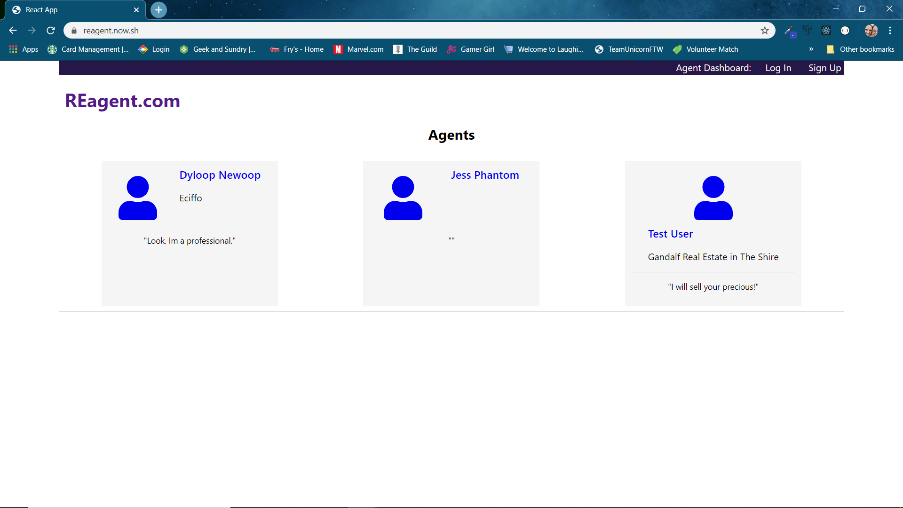
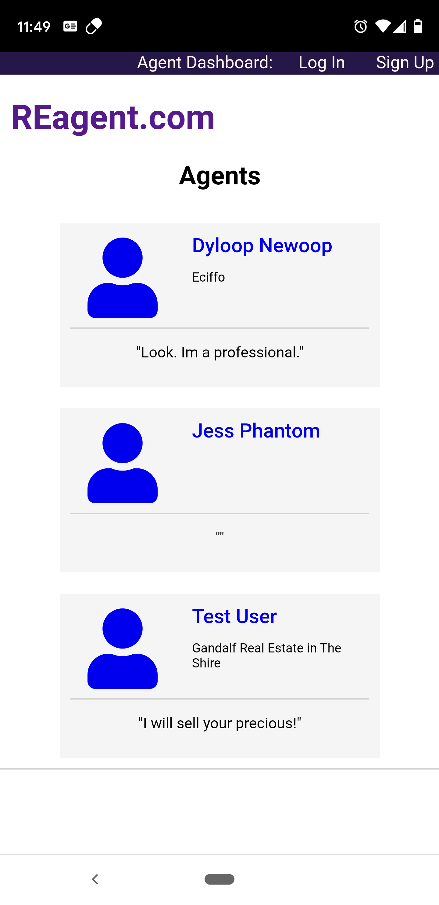
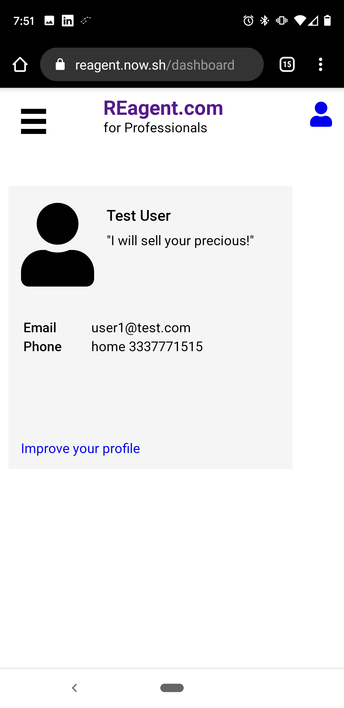

# REagent.com Client

This app is a real estate agent's dashboard that will be editable and supply information to a public profile for users to view

[HTML Wireframes](https://github.com/XanaNite/reagent.com-wireframes)
 
[Server Repo](https://github.com/XanaNite/reagent-server)

## Technologies Used

HTML/CSS/JavaScript/React/JSX/Git/NPM

## App Screenshots
### Fullscreen
Homepage

### Mobile
<table>
  <tr>
    <td align="center">
      <h4>Homepage</h4>
      
    </td>
    <td align="center">
      <h4>Dashboard Homepage</h4>
      
    </td>
    <td align="center">
      <h4>Agent Profile</h4>
      
    </td>
  </tr>
</table>
